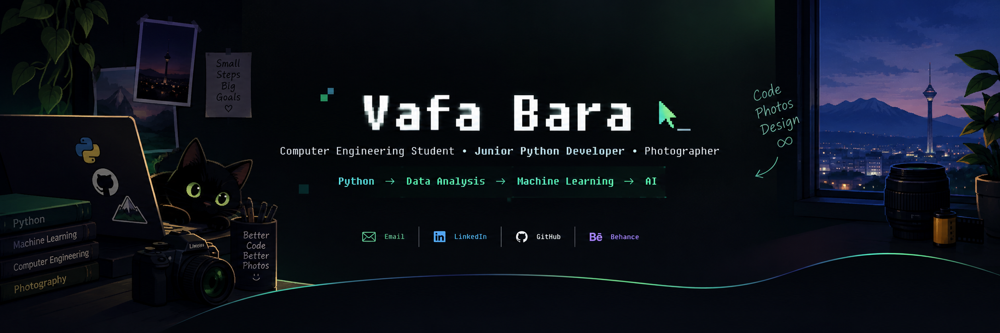

 

  

  

  

## 🧑‍💻 About Me

My curiosity turned into a passion for **Python**, building projects, and exploring **AI** and **ML**. I believe in learning by doing, staying consistent, and turning ideas into reality.

Beyond code, I'm passionate about **photography** and **design**, where creativity meets problem-solving.

📸 **PhotoGrade** is my original idea, built from scratch. I hope it becomes a useful tool for photography teachers and students.

  

## 🚀 What I'm Working On

<table>
<tr>
<td width="50%" valign="top">

### 📷 [PhotoGrade](https://github.com/vafabara/Photography-Grading-Assistant)

A Python desktop application designed to help photography instructors **evaluate students' photos using technical criteria and EXIF metadata**.

**Tech:** Python · Pillow · piexif · CustomTkinter · SQLite · Pandas

> ✅ **v1.1.0 released**

</td>
<td width="50%" valign="top">

### 🤖 Machine Learning Projects

- [**Heart Disease Classification**](https://github.com/vafabara/Heart-Disease-Classification)
- [**Tehran House Price Regression**](https://github.com/vafabara/Tehran-House-Price-Regression)
- [**Customer Segmentation**](https://github.com/vafabara/Customer-Segmentation-clustering)
- [**CineMatch Recommender**](https://github.com/vafabara/CineMacth)

*More projects coming soon...*

</td>
</tr>
</table>

### 🧩 Side Projects

[PixelCrypt](https://github.com/vafabara/PixelCrypt) — [TaskFlow](https://github.com/vafabara/TaskFlow) — [DotArt](https://github.com/vafabara/DotArt)

  

## 🛠️ Technical Skills

### Languages & Development

  

<table>
<tr>
<td align="center" width="150">
 
<strong>Python ⭐</strong>
</td>
<td align="center" width="150">
 
<strong>Git</strong>
</td>
<td align="center" width="150">
 
<strong>GitHub</strong>
</td>
<td align="center" width="150">
 
<strong>VS Code</strong>
</td>
</tr>
</table>

  

<table>
<tr>
<td align="center" width="150">
 
<strong>NumPy ⭐</strong>
</td>
<td align="center" width="150">
 
<strong>Pandas ⭐</strong>
</td>
<td align="center" width="150">
 
<strong>Matplotlib ⭐</strong>
</td>
<td align="center" width="150">
 
<strong>Scikit-learn ⭐</strong>
</td>
</tr>
</table>

**Machine Learning Concepts:** `Regression` `Classification` `Clustering` `Model Evaluation` `Data Preprocessing`

**ML Algorithms:** `KNN` `SVM` `Logistic Regression` `Decision Trees` `K-Means` `DBSCAN` `Hierarchical Clustering`

**Application Development & Storage:** `CustomTkinter` `Pillow` `piexif` `SQLite` `Jupyter`

### Design & Productivity

  
  
  
  

  

## 🎨 Photography & Design

I also work on **photography and graphic design projects**, including street photography, product photography, and visual content created for businesses.

### 📸 Photography Portfolio

👉 **[Explore my Behance portfolio](https://www.behance.net/vafabara)**

  

## 📜 Certificates & Licenses

- [**Python Certificate**](assets/python.png)
- [**Machine Learning Certificate**](assets/ML.png)
- **Deep Learning Certificate**

  

## 📫 Connect With Me

  
  
  
  

Gmail adresse : vafabara@gmail.com
